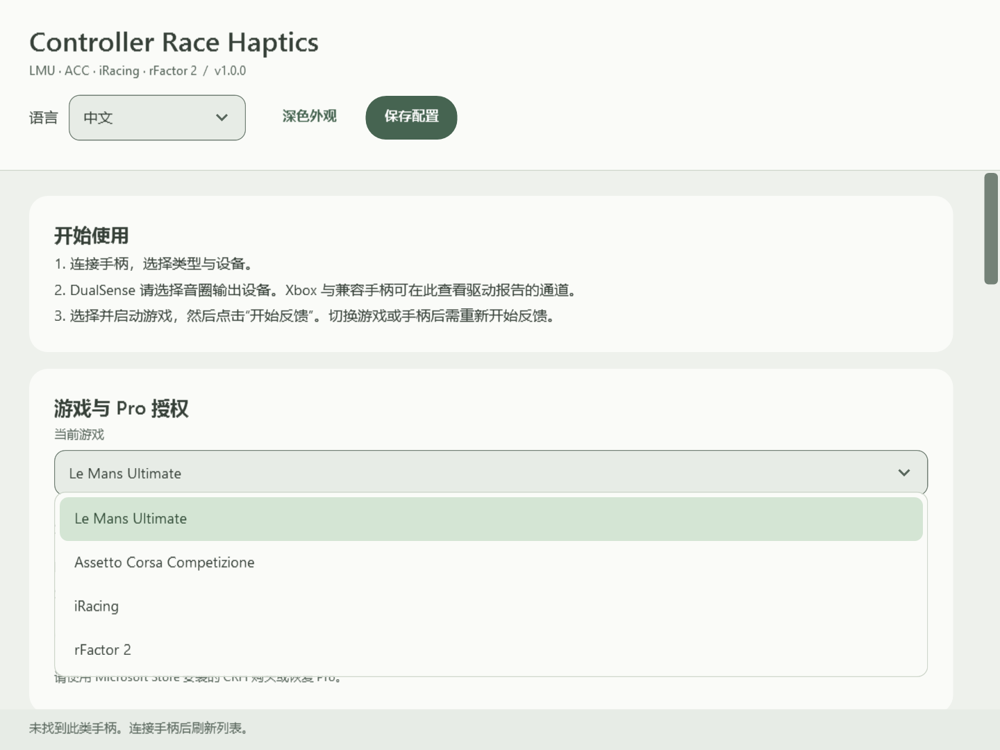
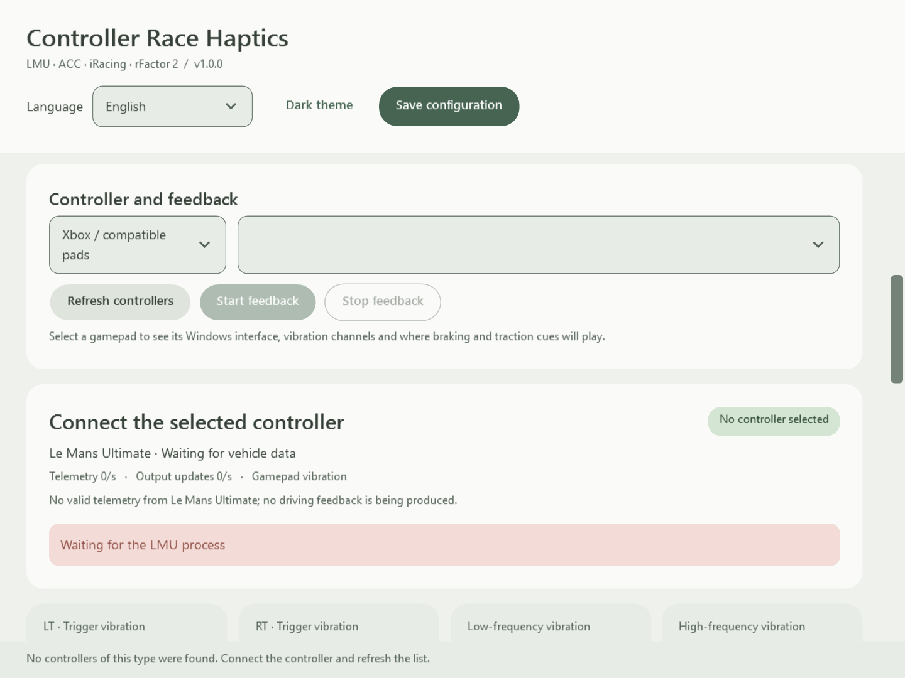
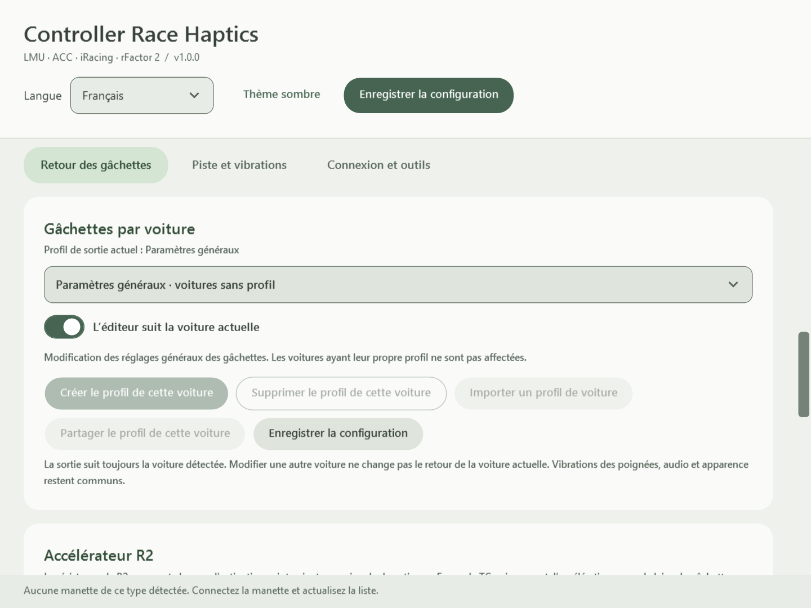
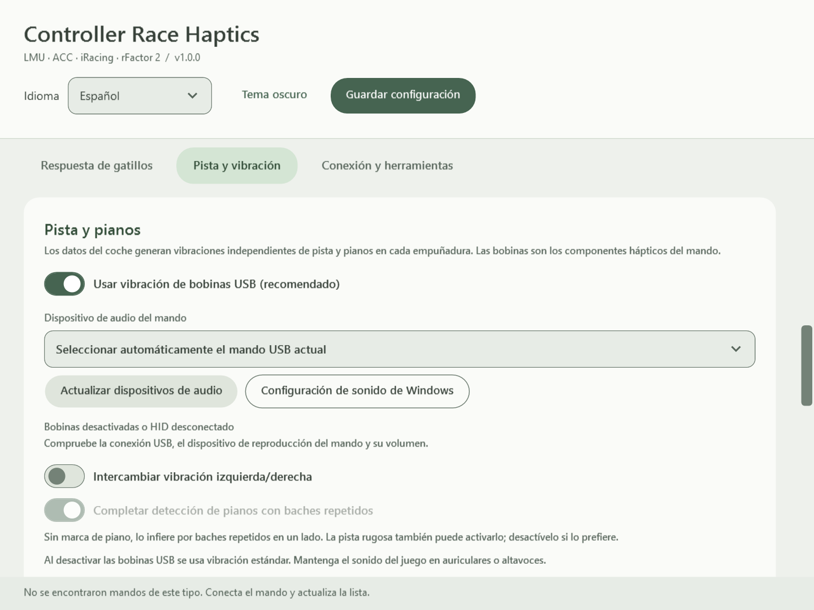
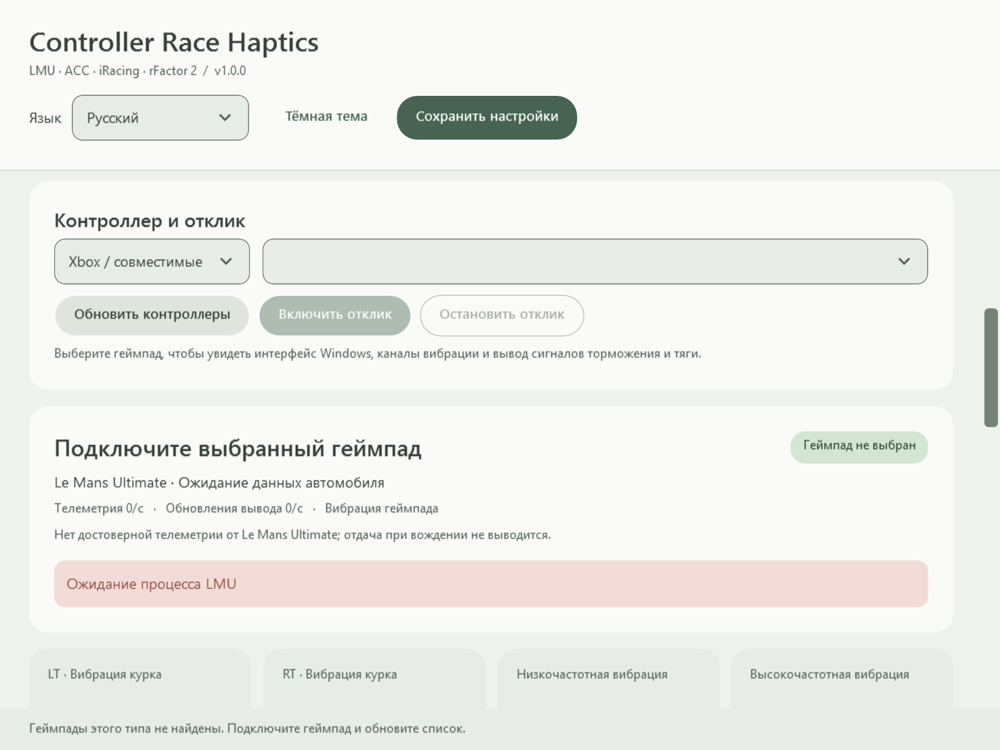
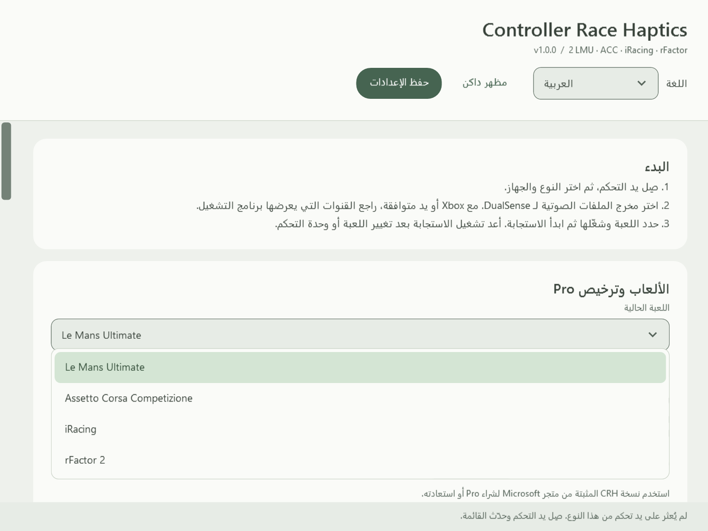

# Controller Race Haptics

CRH 将赛车模拟器的遥测转换为 Windows 手柄的扳机和振动反馈。支持 Le Mans Ultimate、Assetto Corsa Competizione、iRacing 和 rFactor 2。免费版可切换游戏，每款模拟器的 Pro 可独立买断。

Controller Race Haptics turns racing simulator telemetry into trigger and vibration feedback on Windows. The free tier lets you switch between the four supported simulators. Pro is a separate one-time purchase for each simulator.

[隐私政策 / Privacy policy](PRIVACY.md) · [CRH 问题反馈 / Project support](https://github.com/zonda-xu/Controller-Race-Haptics-public/issues)

## 商店一览 / Microsoft Store listings

点击语言可查看该语言的应用介绍、功能、设备要求和四张带说明的原始截图。Each language page includes its Store description, features, hardware requirements and four full-size screenshots with captions.

[下载六种语言的说明与截图 / Download all listing assets (ZIP)](https://github.com/zonda-xu/Controller-Race-Haptics-public/archive/refs/heads/main.zip)

在 Partner Center 打开对应语言的「Store 一览」，将 `01` 至 `04` 的 PNG 按序上传到「桌面截图」，并填入每张图下方的本地化图注。In each language’s Store listing, upload the four PNGs under Desktop screenshots in numerical order and use the caption below each image.

| 语言 / Language | 简介 / Overview | 界面预览 / Preview |
| --- | --- | --- |
| [**简体中文**](store/zh-CN/README.md) | 通过手柄感受路肩、刹车和牵引力变化。CRH 根据模拟器遥测和手柄可用的振动通道生成反馈。 |  |
| [**English**](store/en/README.md) | Feel the difference between a kerb strike and a braking warning. CRH turns racing telemetry into feedback your controller can play. |  |
| [**Français**](store/fr/README.md) | Ressentez la différence entre un passage sur un vibreur et une alerte de freinage. CRH traduit la télémétrie en sensations adaptées à votre manette. |  |
| [**Español**](store/es/README.md) | Distingue al tacto un piano de un aviso de frenada. CRH convierte la telemetría del simulador en efectos que tu mando puede reproducir. |  |
| [**Русский**](store/ru/README.md) | Почувствуйте на геймпаде наезд на поребрик и приближение к пределу торможения. CRH формирует отклик по телеметрии симулятора с учётом возможностей устройства. |  |
| [**العربية**](store/ar/README.md) | ميّز بيديك بين ملامسة حافة الحلبة والتنبيه إلى شدة الفرملة. يحوّل CRH بيانات المحاكاة إلى مؤثرات تناسب قدرات وحدة التحكم لديك. |  |

截图来自 Windows x64 正式版 1.0.0，展示免费版在未连接手柄、模拟器未运行时的界面。各通道显示的是此时的实际状态。

Screenshots show version 1.0.0 for Windows x64 in the free tier, with no controller or simulator connected. Output indicators reflect that state.

如需反馈设备问题，请在本项目的 Issues 注明游戏、手柄型号和连接方式。Issues 为公开页面，请勿发布账户或订单信息。

For device issues, include the simulator, controller model and connection type in the project tracker. Keep account and purchase information private.
