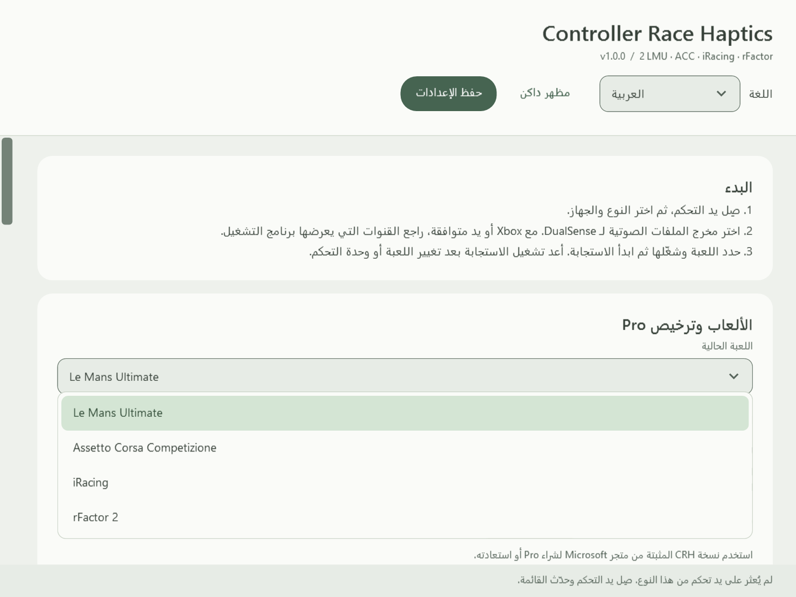
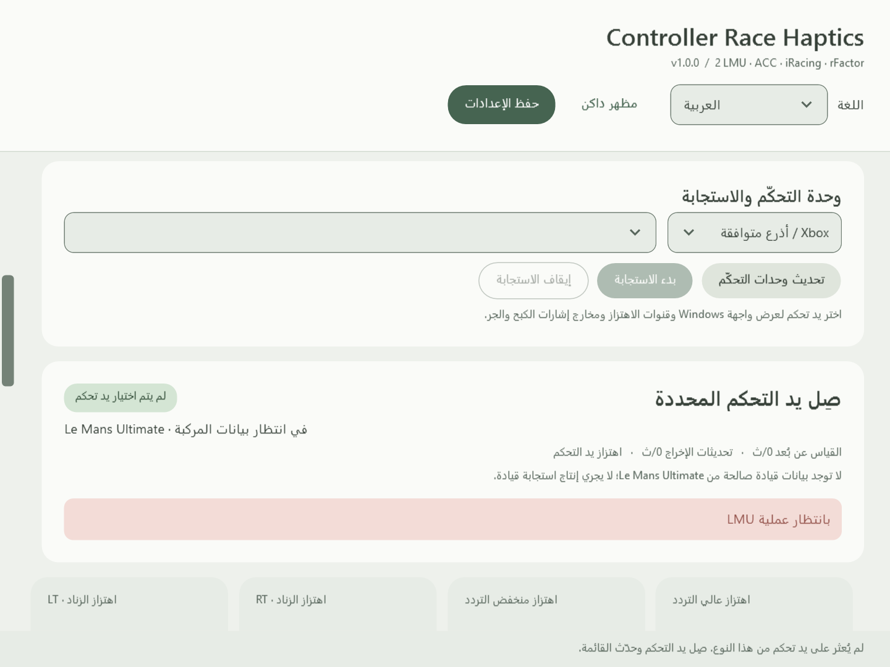
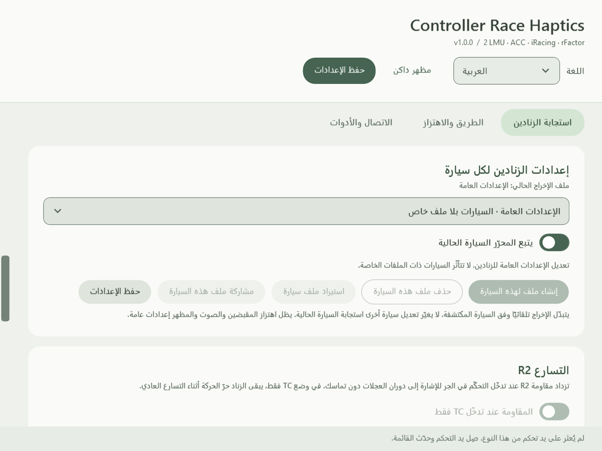
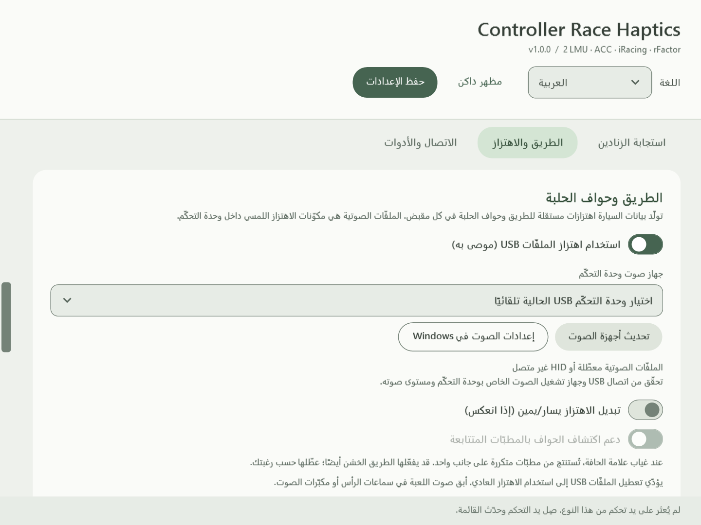

# Controller Race Haptics

**العربية · Windows x64 · 1.0.0**

## الوصف المختصر

ميّز بيديك بين ملامسة حافة الحلبة والتنبيه إلى شدة الفرملة. يحوّل CRH بيانات المحاكاة إلى مؤثرات تناسب قدرات وحدة التحكم لديك.

## الوصف

يستخدم Controller Race Haptics بيانات القيادة التي توفرها لعبة المحاكاة على جهازك ليعبّر عن الفرملة والتماسك وسطح الحلبة عبر وحدة التحكم. يدعم التطبيق Le Mans Ultimate وAssetto Corsa Competizione وiRacing وrFactor 2.

عند توصيل DualSense عبر USB، ينقل الزنادان التكيفيان L2 وR2 إحساس الفرملة والتسارع، وتنقل المشغلات ذات الملفات الصوتية اهتزازات الطريق وحواف الحلبة. مع وحدات Xbox والوحدات المتوافقة معها، يستخدم التطبيق قنوات الاهتزاز التي يتيحها برنامج تشغيل Windows. إذا اقتصر الاهتزاز على المقابض أو هيكل الوحدة، يمكنك إعطاء الأولوية لإشارات الفرملة والتماسك أو لمؤثرات الطريق وحواف الحلبة.

يمكنك استخدام النسخة المجانية دون حد زمني والتبديل بين ألعاب المحاكاة، مع تفعيل لعبة واحدة في كل مرة. تشمل النسخة مؤثرات الطريق وحواف الحلبة الأساسية وإشارات نظام منع انغلاق المكابح ونظام التحكم في الجر عندما توفرها اللعبة. لكل لعبة ترقية Pro مستقلة تُشترى مرة واحدة وتتيح مؤثرات متقدمة وضبط الإعدادات لكل سيارة واستيراد ملفات الإعدادات وتصديرها. ففي Le Mans Ultimate مثلاً، يمكن للسيارات المدعومة التي لا تستخدم نظام منع انغلاق المكابح أن تنبّهك عند الاقتراب من حدّ الفرملة. تعتمد المؤثرات على اللعبة ووحدة التحكم.

## الميزات

- التبديل بين أربع ألعاب محاكاة وتفعيل واحدة منها في النسخة المجانية
- استجابة الزنادين التكيفيين ومؤثرات سطح الحلبة مع DualSense عبر USB
- توزيع الاهتزاز وفق المحركات المتاحة في وحدات Xbox والوحدات المتوافقة
- ترقية Pro بشراء واحد لكل لعبة مع إعدادات متقدمة وملفات مستقلة للسيارات

## النظام والأجهزة

يتطلب التطبيق Windows بمعمارية x64 ووحدة تحكم متوافقة وإحدى ألعاب المحاكاة المدعومة مثبّتة بشكل منفصل. لاستخدام rFactor 2، فعّل المكوّن الإضافي rF2 Shared Memory Map.

## لقطات الشاشة

افتح قائمة الألعاب واختر LMU أو ACC أو iRacing أو rFactor 2.

اختر وحدات Xbox أو الوحدات المتوافقة معها، ثم حدّث قائمة الأجهزة وتحقّق من حالة الاتصال.

يعرض تبويب الزنادين ملف الإعدادات النشط وأدوات إنشاء ملفات السيارات واستيرادها ومشاركتها. يتطلب تعديل هذه الملفات ترقية Pro للعبة المحددة.

تضم إعدادات اهتزاز DualSense جهاز إخراج الصوت والقناتين اليمنى واليسرى وخيارات حواف الحلبة.
