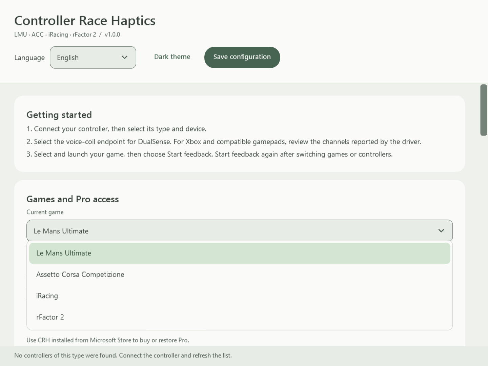
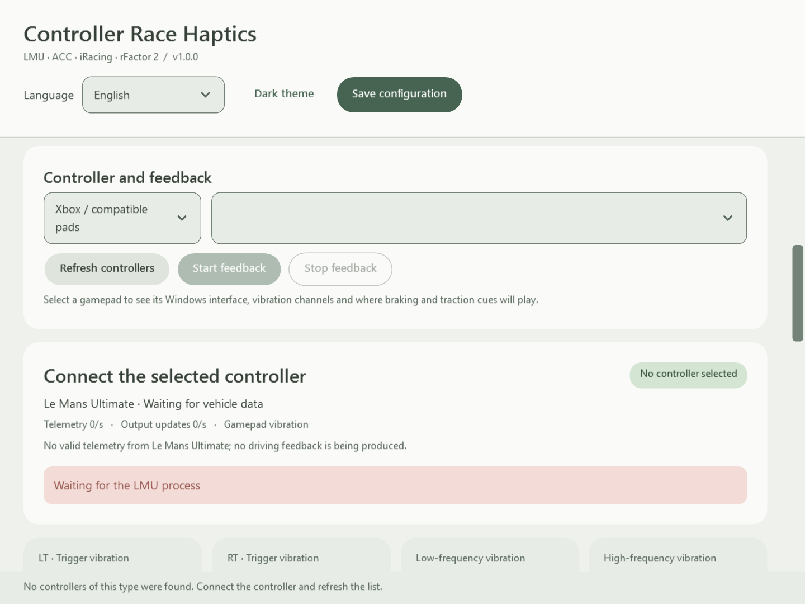
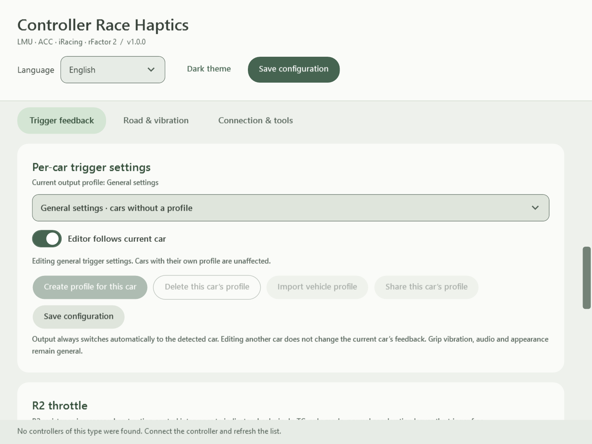
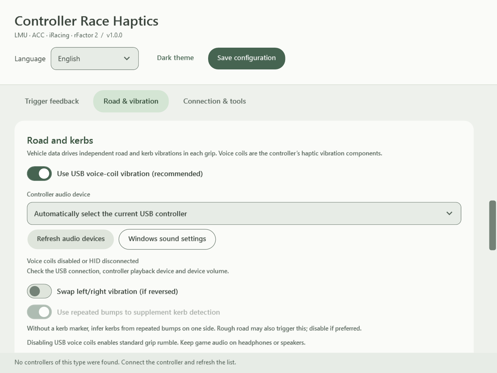

# Controller Race Haptics

**English · Windows x64 · 1.0.0**

## Short description

Feel the difference between a kerb strike and a braking warning. CRH turns racing telemetry into feedback your controller can play.

## Description

Controller Race Haptics turns local simulator telemetry into cues you can feel through a gamepad. It supports Le Mans Ultimate, Assetto Corsa Competizione, iRacing and rFactor 2.

Connect a DualSense over USB for adaptive brake and throttle triggers and voice-coil feedback from the road and kerbs. On Xbox and compatible gamepads, the app uses the channels exposed by the Windows driver. If your pad has only grip or body vibration, choose whether braking and traction cues or road and kerb effects take priority.

The free tier lets you switch between simulators and use one at a time, with basic road and kerb feedback and ABS or traction-control cues where the game supplies them. A separate one-time Pro purchase for each simulator unlocks advanced feedback, per-car tuning and profile import and export for that game. In Le Mans Ultimate, for example, supported cars without ABS can give you a warning as you approach the braking limit. Effects depend on the game and controller.

## Features

- Switch between four simulators, one at a time in the free tier
- Adaptive triggers and voice-coil road feedback on DualSense over USB
- Vibration mapped to the Xbox-compatible channels available on your controller
- One-time Pro purchase per simulator for advanced feedback and car profiles

## System and hardware

Windows x64, a compatible controller and a separately installed supported simulator. For rFactor 2, enable the rF2 Shared Memory Map plugin.

## Screenshots

Open the game list to choose LMU, ACC, iRacing or rFactor 2.

Select Xbox or compatible gamepads, refresh the controller list and check the connection state.

The trigger tab shows the active profile and the controls to create, import and share car profiles. Editing requires Pro for that game.

DualSense vibration settings include the audio output device, left and right channels, and kerb feedback options.
