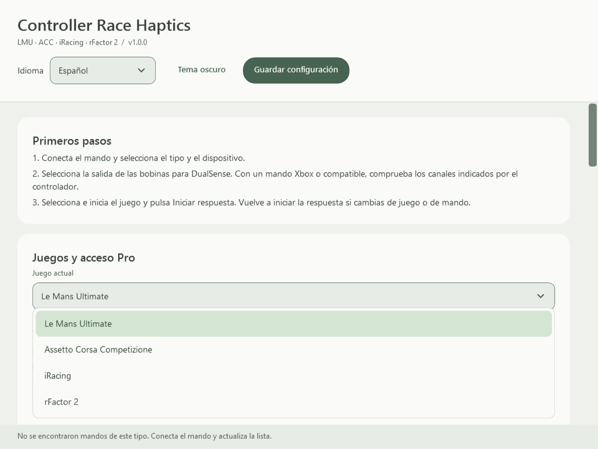
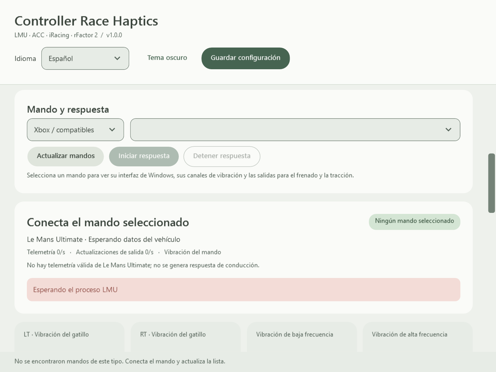
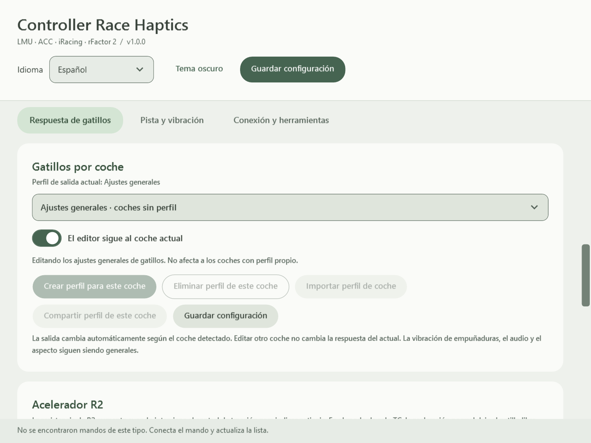
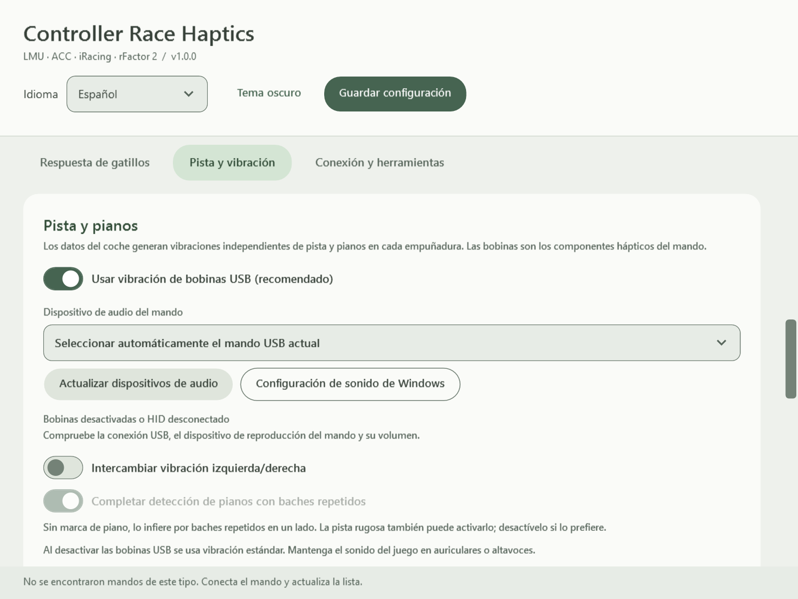

# Controller Race Haptics

**Español · Windows x64 · 1.0.0**

## Descripción breve

Distingue al tacto un piano de un aviso de frenada. CRH convierte la telemetría del simulador en efectos que tu mando puede reproducir.

## Descripción

Controller Race Haptics lee la telemetría local del simulador y transmite al mando información sobre frenada, tracción y superficie de la pista. Es compatible con Le Mans Ultimate, Assetto Corsa Competizione, iRacing y rFactor 2.

Conecta un DualSense por USB para sentir el freno y el acelerador en los gatillos adaptativos, y el asfalto y los pianos a través de los actuadores de bobina móvil. Con mandos Xbox y compatibles, la aplicación utiliza los canales que ofrece el controlador de Windows. Si solo vibran las empuñaduras o el cuerpo del mando, puedes dar prioridad a la frenada y la tracción, o al asfalto y los pianos.

La versión gratuita te permite cambiar de simulador y usar uno a la vez sin límite de tiempo. Incluye efectos básicos de pista y pianos, además de avisos de ABS y control de tracción cuando el juego proporciona esos datos. Cada simulador tiene su propia compra única de Pro, que desbloquea efectos avanzados, ajustes por coche e importación y exportación de perfiles para ese juego. En Le Mans Ultimate, por ejemplo, los coches compatibles sin ABS pueden avisarte al acercarte al límite de frenada. Los efectos dependen del juego y del mando.

## Funciones

- Cuatro simuladores disponibles, uno activo a la vez en la versión gratuita
- Gatillos adaptativos y efectos de pista con DualSense por USB
- Vibración según los motores disponibles en los mandos Xbox y compatibles
- Compra única de Pro por simulador para ajustes avanzados y perfiles por coche

## Sistema y dispositivos

Windows x64, un mando compatible y un simulador compatible instalado por separado. Para rFactor 2, activa el complemento rF2 Shared Memory Map.

## Capturas de pantalla

Abre la lista de juegos para elegir LMU, ACC, iRacing o rFactor 2.

Selecciona mandos Xbox o compatibles, actualiza la lista de mandos y comprueba la conexión.

La pestaña de gatillos muestra el perfil activo y los controles para crear, importar y compartir perfiles por coche. Para editarlos se necesita Pro para ese juego.

Los ajustes de vibración del DualSense incluyen la salida de audio, los canales izquierdo y derecho y los efectos de los pianos.
