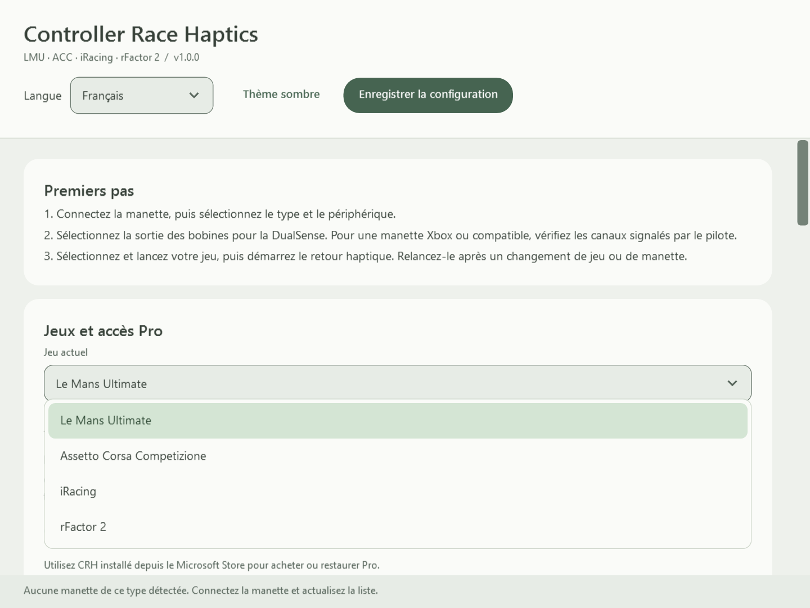
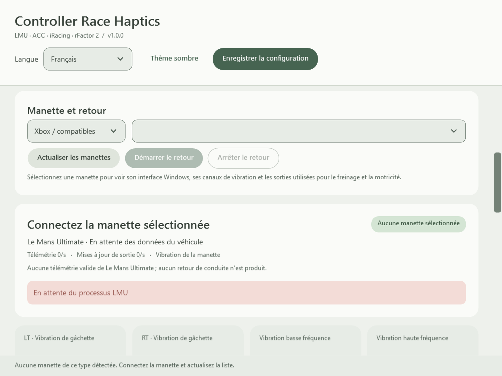
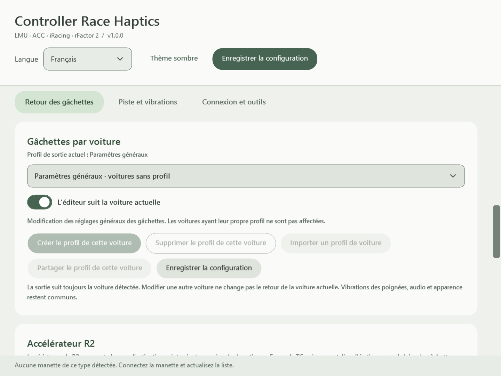
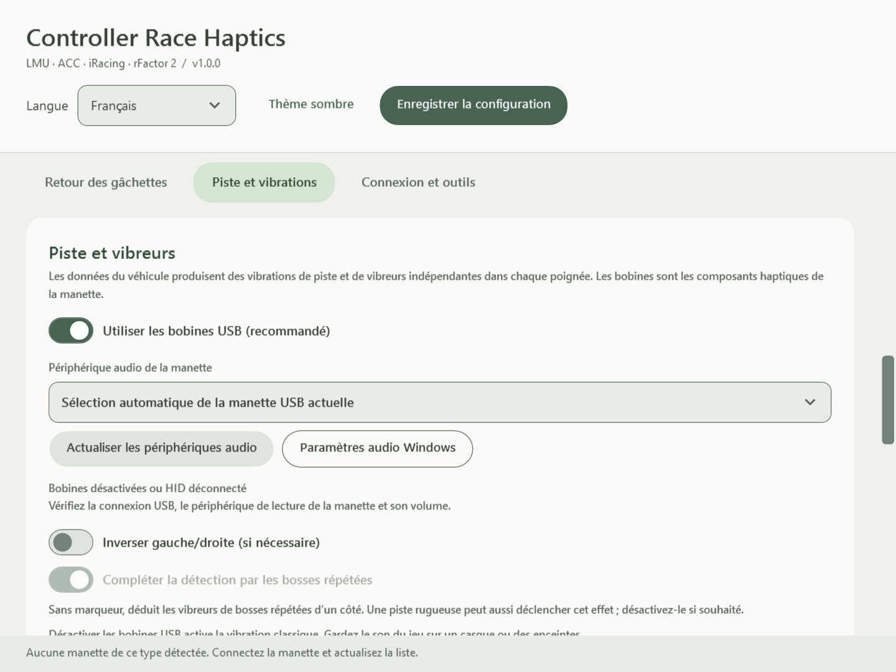

# Controller Race Haptics

**Français · Windows x64 · 1.0.0**

## Description courte

Ressentez la différence entre un passage sur un vibreur et une alerte de freinage. CRH traduit la télémétrie en sensations adaptées à votre manette.

## Description

Controller Race Haptics utilise la télémétrie locale du simulateur pour transmettre à la manette des informations sur le freinage, la motricité et la piste. L’application prend en charge Le Mans Ultimate, Assetto Corsa Competizione, iRacing et rFactor 2.

Avec une DualSense connectée en USB, les gâchettes adaptatives transmettent les effets de freinage et d’accélération, tandis que les bobines mobiles restituent la piste et les vibreurs. Sur une manette Xbox ou compatible, les effets utilisent les canaux exposés par le pilote Windows. Si seules les poignées ou le corps de la manette vibrent, vous pouvez donner la priorité au freinage et à la motricité, ou à la piste et aux vibreurs.

La version gratuite permet de changer de simulateur et d’en utiliser un à la fois, sans limite de durée. Elle inclut les effets de base de la piste et des vibreurs, ainsi que les interventions de l’ABS et de l’antipatinage lorsque le jeu les signale. Un achat Pro unique par simulateur débloque les effets avancés, le réglage par voiture et l’importation et l’exportation de profils pour ce jeu. Dans Le Mans Ultimate, par exemple, les voitures compatibles sans ABS peuvent signaler l’approche de la limite de freinage. Le rendu dépend du jeu et de la manette.

## Fonctionnalités

- Quatre simulateurs au choix, un actif à la fois en version gratuite
- Gâchettes adaptatives et effets de piste sur DualSense en USB
- Répartition des vibrations selon les moteurs disponibles sur la manette
- Achat Pro permanent par simulateur pour les réglages et profils par voiture

## Système et matériel

Windows x64, une manette compatible et un simulateur pris en charge, installé séparément. Pour rFactor 2, activez le module rF2 Shared Memory Map.

## Captures d’écran

Ouvrez la liste des jeux pour choisir LMU, ACC, iRacing ou rFactor 2.

Sélectionnez la sortie Xbox ou compatible, actualisez la liste des manettes et vérifiez la connexion.

L’onglet des gâchettes présente le profil actif et les commandes de création, d’importation et de partage. La modification des profils par voiture nécessite Pro pour ce jeu.

Les réglages de vibration DualSense regroupent la sortie audio, les canaux gauche et droit et les options pour les vibreurs.
