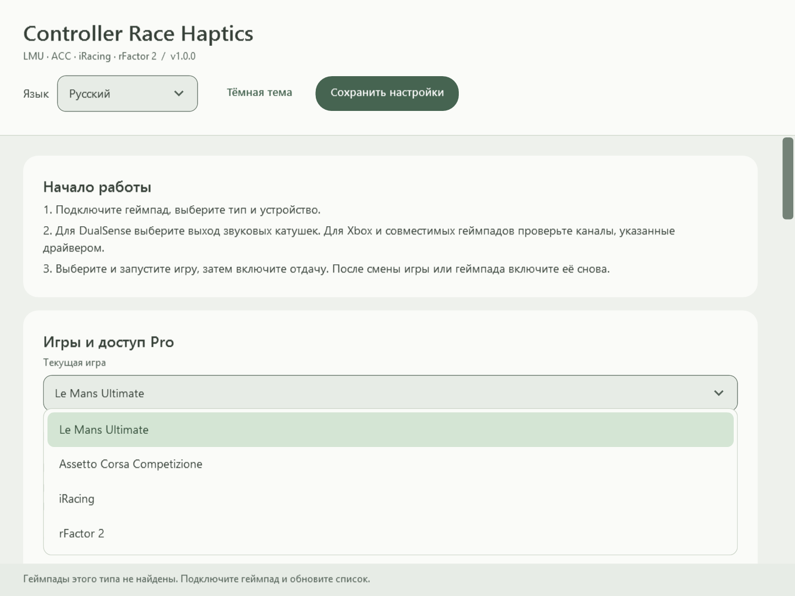
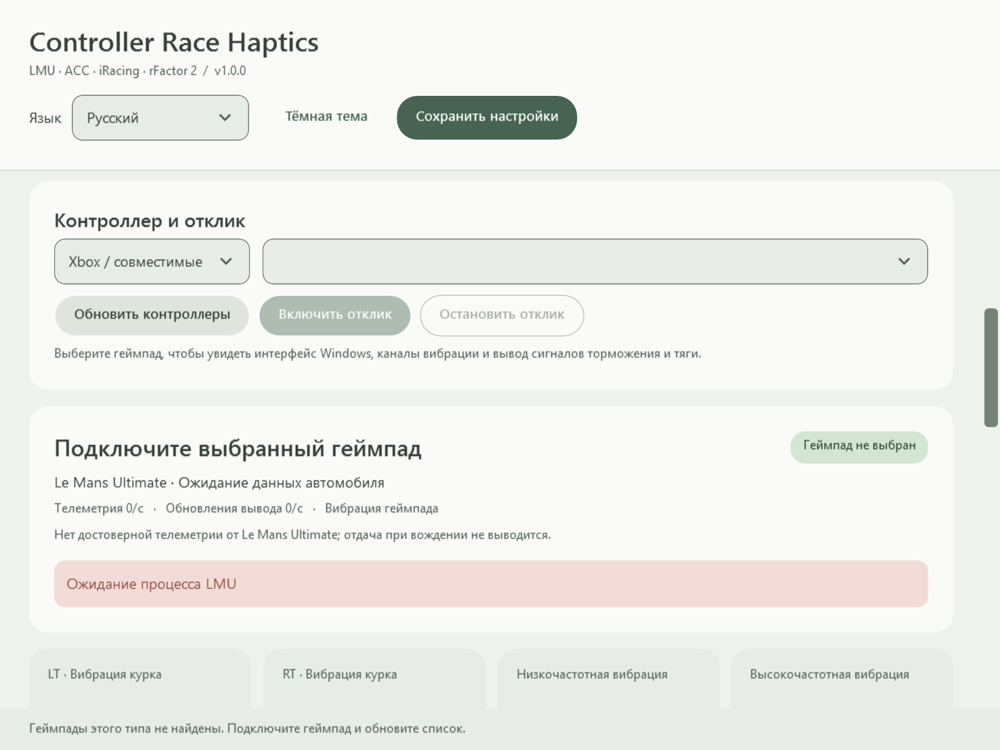
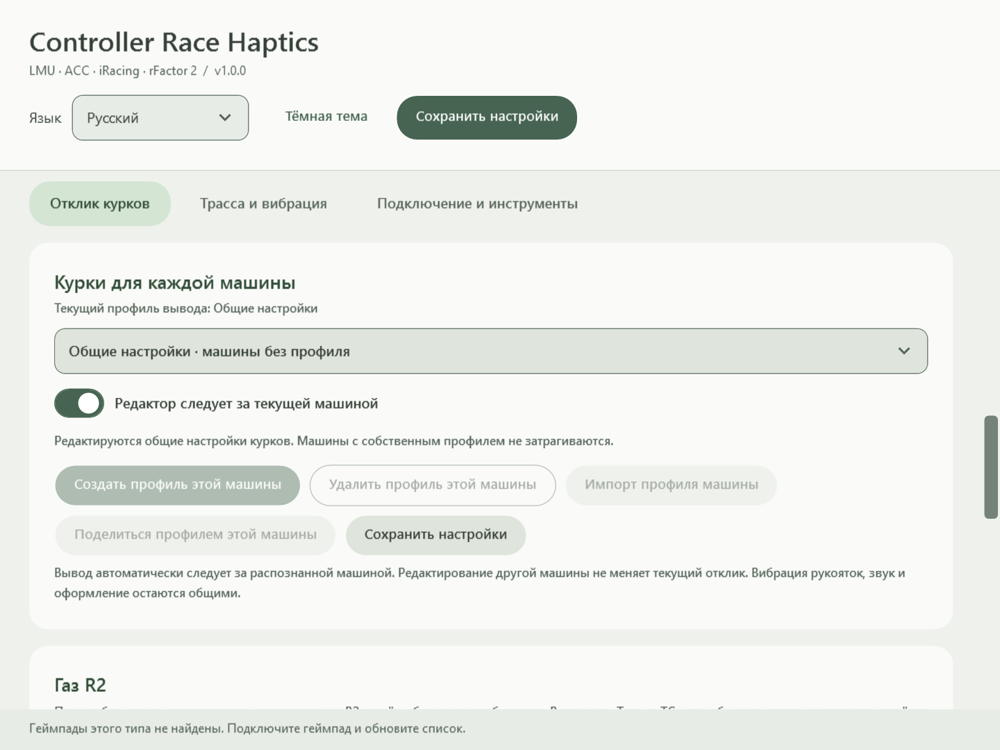
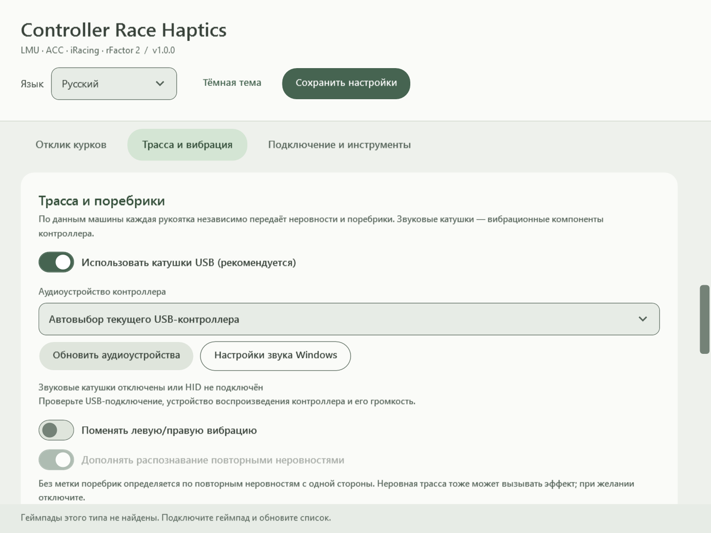

# Controller Race Haptics

**Русский · Windows x64 · 1.0.0**

## Краткое описание

Почувствуйте на геймпаде наезд на поребрик и приближение к пределу торможения. CRH формирует отклик по телеметрии симулятора с учётом возможностей устройства.

## Описание

Controller Race Haptics превращает локальную телеметрию симулятора в тактильные сигналы о торможении, тяге и состоянии трассы. Поддерживаются Le Mans Ultimate, Assetto Corsa Competizione, iRacing и rFactor 2.

На DualSense с подключением по USB адаптивные курки передают отклик тормоза и газа, а приводы со звуковыми катушками — неровности трассы и поребрики. На геймпадах Xbox и совместимых моделях используются каналы вибрации, доступные через драйвер Windows. Если вибрируют только рукоятки или корпус, можно выбрать приоритет сигналов торможения и тяги либо эффектов дороги и поребриков.

Бесплатной версией можно пользоваться без ограничения по времени. Вы можете переключаться между симуляторами, выбирая один за раз. Доступны базовые эффекты трассы и поребриков, а также сигналы ABS и противобуксовочной системы, если игра передаёт эти данные. Для каждого симулятора Pro приобретается отдельно одним платежом и открывает расширенные эффекты, настройку для каждой машины, импорт и экспорт профилей. Например, в Le Mans Ultimate на поддерживаемых машинах без ABS можно почувствовать приближение к пределу торможения. Набор эффектов зависит от игры и геймпада.

## Возможности

- Четыре симулятора на выбор, один активен в бесплатной версии
- Адаптивные курки и эффекты дороги на DualSense по USB
- Распределение вибрации с учётом доступных моторов геймпада
- Однократная покупка Pro для выбранного симулятора и профили для отдельных машин

## Система и оборудование

Windows x64, совместимый геймпад и отдельно установленный симулятор из списка поддерживаемых. Для rFactor 2 включите плагин rF2 Shared Memory Map.

## Снимки экрана

Откройте список игр и выберите LMU, ACC, iRacing или rFactor 2.

Выберите геймпады Xbox и совместимые модели, обновите список устройств и проверьте состояние подключения.

На вкладке курков видны текущий профиль и команды для создания, импорта и обмена профилями машин. Для редактирования нужен Pro для выбранной игры.

В настройках вибрации DualSense доступны выбор аудиовыхода, левого и правого каналов и параметры эффектов поребриков.
