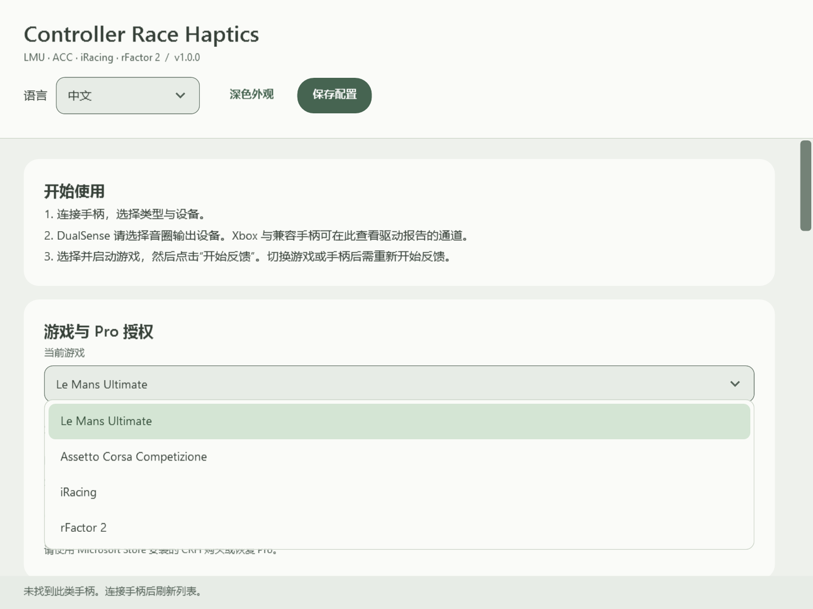
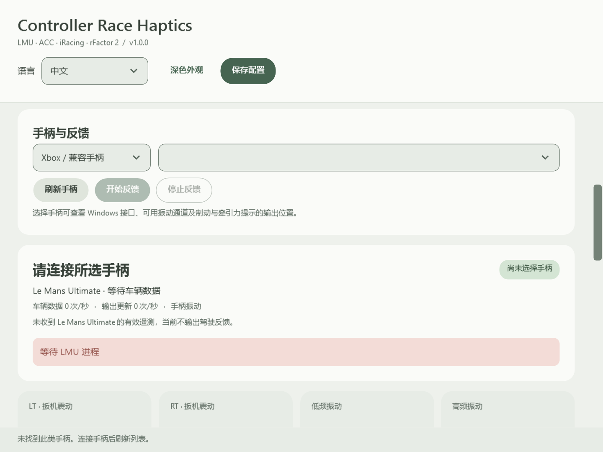
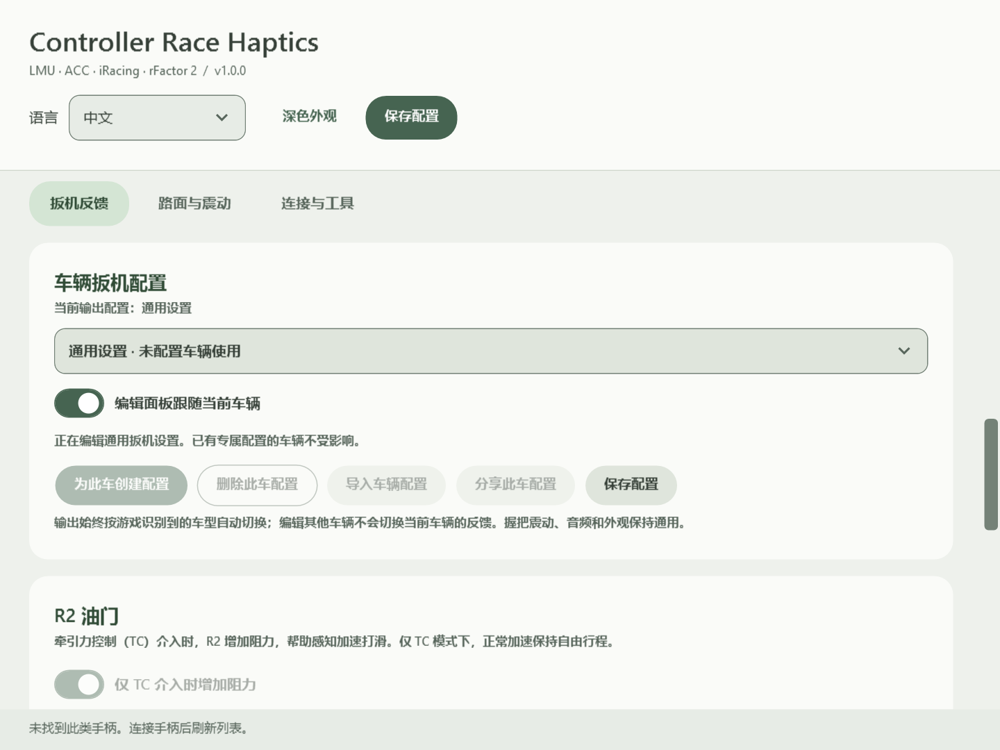
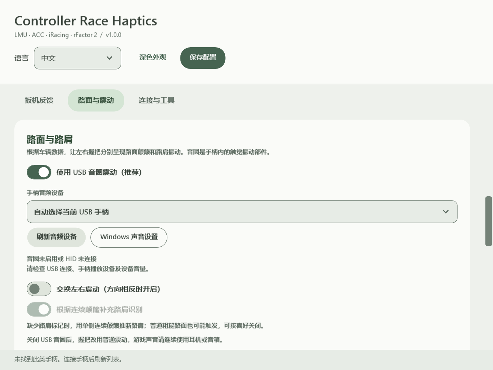

# Controller Race Haptics

**简体中文 · Windows x64 · 1.0.0**

## 简短说明

通过手柄感受路肩、刹车和牵引力变化。CRH 根据模拟器遥测和手柄可用的振动通道生成反馈。

## 说明

打滑和压过路肩在手上是什么感觉？Controller Race Haptics 读取模拟器在本机提供的遥测，将制动、牵引和路面信号转成手柄反馈。支持 Le Mans Ultimate、Assetto Corsa Competizione、iRacing 和 rFactor 2。

通过 USB 连接 DualSense，可用自适应扳机感受制动和油门反馈，并通过音圈分辨路面与路肩。Xbox 和兼容手柄按 Windows 驱动提供的通道输出振动。如果手柄只有握把或机身振动，可以选择优先感受制动／牵引，或优先感受路面／路肩。

免费版可长期使用，一次选择一款模拟器，也可随时切换。基础功能包括路面、路肩以及游戏能提供的 ABS 和牵引力控制反馈。每款模拟器的 Pro 均可单独永久买断，解锁该游戏的高级反馈、每车调校和配置导入与导出。例如在 Le Mans Ultimate 中，支持的无 ABS 车型可获得临界制动提示。具体效果取决于游戏遥测与手柄能力。

## 功能

- 四款模拟器可切换，免费版一次启用一款
- DualSense USB 自适应扳机与音圈反馈
- Xbox 兼容手柄按可用马达输出，握把振动可选优先级
- 按游戏买断 Pro，调整并交换车型配置

## 系统与设备

Windows x64、兼容手柄和单独安装的受支持模拟器。rFactor 2 需要启用 rF2 Shared Memory Map 插件。

## 界面截图

展开游戏列表，选择 LMU、ACC、iRacing 或 rFactor 2。

切换到 Xbox 或兼容手柄，刷新设备列表并查看连接状态。

扳机页显示当前配置以及创建、导入和分享车型配置的入口。相应游戏的 Pro 可编辑车型配置。

DualSense 振动设置包括音频输出设备、左右声道和路肩选项。
